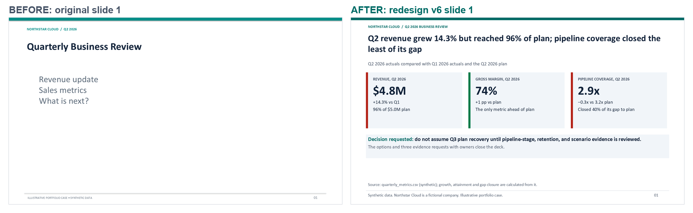
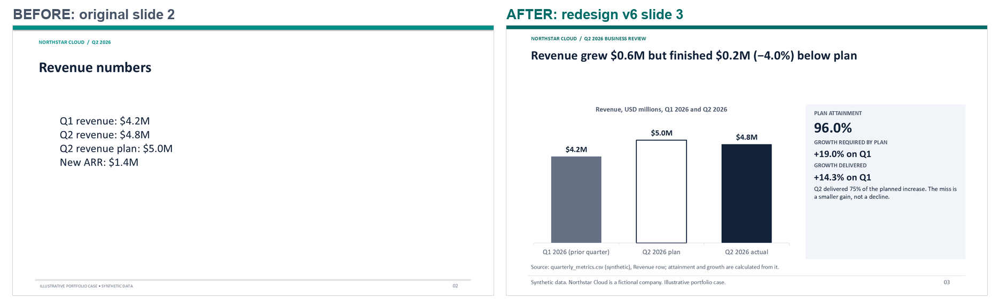
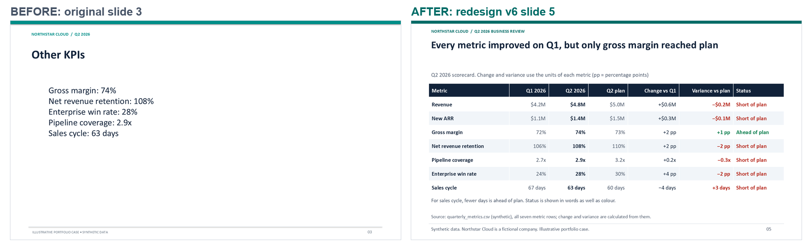
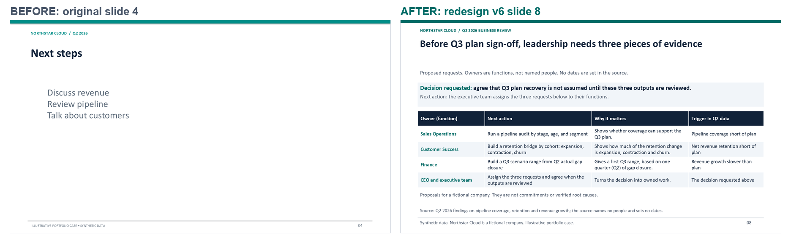
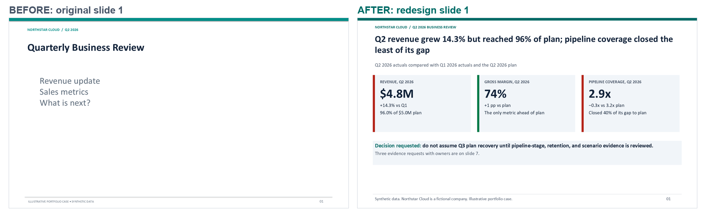
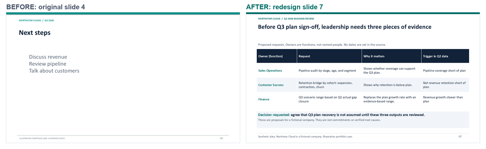

# Case 01 — Northstar Cloud Q2 2026 Business Review

**Data disclosure.** Northstar Cloud is a fictional company. All data is synthetic and was made for this portfolio.

## The business problem
A finance team had a four-slide quarterly business review: a generic agenda, revenue figures without comparison, KPIs without plan or period, and next steps without owners. A leadership team could not decide anything from it.

## The assignment
Check the numbers, state what they mean, rebuild the original deck faithfully, and produce an executive version that leads to a decision, with each change explained.

## Method
1. Validate the source data (schema, units, periods, ranges) and compute every metric once, in one calculation engine.
2. Assess the business: separate facts, calculations, interpretations, and recommendations.
3. Rebuild the original deck from a declared specification and prove the rebuild with an element comparison and a pixel comparison.
4. Redesign the deck around one answer and one decision. Every number on a slide is produced from the calculation engine and recorded in a claims register.
5. Run automated deck checks (contrast, titles, alt text, editability, traceability) and inspect every rendered slide.
6. Version 6: apply the project's draft Sales Presentation Engineering Standard (DRAFT / NOT CERTIFIED). It asks for assertion titles, the decision first, an evidence register, two delivery modes, and no slide without evidence. No conformance to it is claimed.

## Results
| Measure | Result |
|---|---|
| Revenue growth, Q2 vs Q1 | 14.3 % (4.8 vs 4.2, USD millions) |
| Plan attainment | 96.0 % (USD 0.2 M below plan) |
| Implied gross profit vs plan | USD 0.10 M below plan, although gross margin beat plan by 1 point (derived; assumption stated on the slide) |
| Pipeline coverage | Closed 40 % of its gap to plan, the lowest of the seven metrics |
| Faithful rebuild | 0 material differences; 0.0000 % changed pixels on 4 of 4 slides |
| Executive deck v6, presenter deck | 9 slides; 96 of 96 figures traced to source or calculation; automated deck checks: 100 pass, 0 fail |
| Executive deck v6, standalone leave-behind | 10 slides (a reading guide comes first); 96 of 96 figures traced; automated deck checks: 110 pass, 0 fail |
| Previous version v5 (archived) | 8 slides; 98 of 98 figures traced |

## What changed from v5 to v6
- Two delivery modes from one storyboard: a presenter deck with the talk track in the speaker notes, and a leave-behind with full caveats and a glossary on the slides. Titles, figures, and slide order are the same.
- A new options slide: sign off the Q3 plan now, or review the evidence first. Costs are stated as unknown.
- The decision slide puts the decision first and gives a next action to each function, including the executive team.
- A source line on every slide with a figure.
- The data-notes slide lists four omitted narrative steps (cost of inaction, market insight, proof, business case) and why each has no evidence.
- Every slide has a Changed / Unchanged / Why record in the reasoning log.

## Deliverables
- Executive deck, version 6 (current): presenter deck [PowerPoint](../deliverables/northstar_cloud/executive_revenue_review_v6.pptx) and [PDF](../deliverables/northstar_cloud/executive_revenue_review_v6.pdf); standalone leave-behind [PowerPoint](../deliverables/northstar_cloud/executive_revenue_review_v6_leave_behind.pptx) and [PDF](../deliverables/northstar_cloud/executive_revenue_review_v6_leave_behind.pdf).
- Claims register for both v6 decks, with source or calculation, unit, period, and mode for each figure: [claims_register_v6.csv](../deliverables/northstar_cloud/claims_register_v6.csv).
- Before and after, original slide against v6 presenter slide:

### Slide renders, v6
| Slide | Presenter deck | Leave-behind |
|---|---|---|
| Reading guide | — | [slide 1](../deliverables/northstar_cloud/renders/v6_leave_behind/slide_01.png) |
| Answer | [slide 1](../deliverables/northstar_cloud/renders/v6_presenter/slide_01.png) | [slide 2](../deliverables/northstar_cloud/renders/v6_leave_behind/slide_02.png) |
| Summary | [slide 2](../deliverables/northstar_cloud/renders/v6_presenter/slide_02.png) | [slide 3](../deliverables/northstar_cloud/renders/v6_leave_behind/slide_03.png) |
| Revenue | [slide 3](../deliverables/northstar_cloud/renders/v6_presenter/slide_03.png) | [slide 4](../deliverables/northstar_cloud/renders/v6_leave_behind/slide_04.png) |
| Gross profit | [slide 4](../deliverables/northstar_cloud/renders/v6_presenter/slide_04.png) | [slide 5](../deliverables/northstar_cloud/renders/v6_leave_behind/slide_05.png) |
| Scorecard | [slide 5](../deliverables/northstar_cloud/renders/v6_presenter/slide_05.png) | [slide 6](../deliverables/northstar_cloud/renders/v6_leave_behind/slide_06.png) |
| Pipeline risk | [slide 6](../deliverables/northstar_cloud/renders/v6_presenter/slide_06.png) | [slide 7](../deliverables/northstar_cloud/renders/v6_leave_behind/slide_07.png) |
| Options | [slide 7](../deliverables/northstar_cloud/renders/v6_presenter/slide_07.png) | [slide 8](../deliverables/northstar_cloud/renders/v6_leave_behind/slide_08.png) |
| Decision and next actions | [slide 8](../deliverables/northstar_cloud/renders/v6_presenter/slide_08.png) | [slide 9](../deliverables/northstar_cloud/renders/v6_leave_behind/slide_09.png) |
| Data notes | [slide 9](../deliverables/northstar_cloud/renders/v6_presenter/slide_09.png) | [slide 10](../deliverables/northstar_cloud/renders/v6_leave_behind/slide_10.png) |

### Previous version: v5 (archived)
Version 5 was the public deck before version 6 replaced it (owner decision, 17 October 2026). It is kept for before-and-after comparison: [PowerPoint](../deliverables/northstar_cloud/previous_versions/v5/executive_revenue_review_v5.pptx), [PDF](../deliverables/northstar_cloud/previous_versions/v5/executive_revenue_review_v5.pdf).

## Limits
- Synthetic data: the business records behind the numbers cannot be verified.
- Independent review, the PowerPoint Accessibility Checker, a screen-reader test, an independent comprehension test, and a timed run have not been done.
- All checks are automated checks or internal reviews, including reviews by AI models. Reviewer scores are NOT ASSESSED.

## Capabilities demonstrated
Source verification and metric definition; separation of evidence from interpretation; faithful PowerPoint reconstruction with measured proof; executive storylining; reproducible quality checks with honest status reporting.
