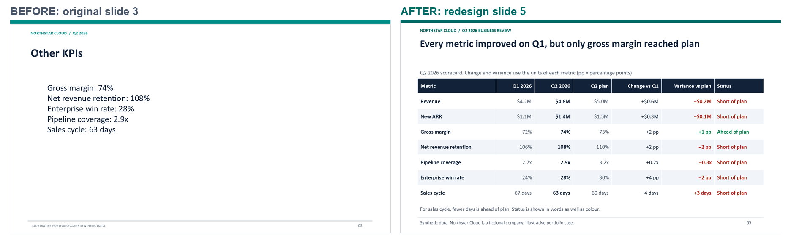

# Case 01 — Northstar Cloud Q2 2026 Business Review

**Data disclosure.** Northstar Cloud is a fictional company. All data is synthetic and was made for this portfolio.

## The business problem
A finance team had a four-slide quarterly business review: a generic agenda, revenue figures without comparison, KPIs without plan or period, and next steps without owners. A leadership team could not decide anything from it.

## The assignment
Check the numbers, state what they mean, rebuild the original deck faithfully, and produce an executive version that leads to a decision, with each change explained.

## Method
1. Validate the source data (schema, units, periods, ranges) and compute every metric once, in one calculation engine.
2. Assess the business: separate facts, calculations, interpretations, and recommendations.
3. Rebuild the original deck from a declared specification and prove the rebuild with an element comparison and a pixel comparison.
4. Redesign the deck around one answer and one decision. Every number on a slide is produced from the calculation engine and recorded in a claims register.
5. Run automated deck checks (contrast, titles, alt text, editability, traceability) and inspect every rendered slide.

## Results
| Measure | Result |
|---|---|
| Revenue growth, Q2 vs Q1 | 14.3 % (4.8 vs 4.2, USD millions) |
| Plan attainment | 96.0 % (USD 0.2 M below plan) |
| Implied gross profit vs plan | USD 0.10 M below plan, although gross margin beat plan by 1 point (derived; assumption stated on the slide) |
| Pipeline coverage | Closed 40 % of its gap to plan, the lowest of the seven metrics |
| Faithful rebuild | 0 material differences; 0.0000 % changed pixels on 4 of 4 slides |
| Executive deck | 8 slides; native charts and tables; 98 of 98 figures traced to source or calculation; automated deck checks pass |

## Deliverables
- Executive deck, version 5: [PowerPoint](../deliverables/northstar_cloud/executive_revenue_review_v5.pptx), [PDF](../deliverables/northstar_cloud/executive_revenue_review_v5.pdf).
- Before and after:

## Limits
- Synthetic data: the business records behind the numbers cannot be verified.
- Independent review, the PowerPoint Accessibility Checker, a screen-reader test, and a timed run have not been done.

## Capabilities demonstrated
Source verification and metric definition; separation of evidence from interpretation; faithful PowerPoint reconstruction with measured proof; executive storylining; reproducible quality checks with honest status reporting.
